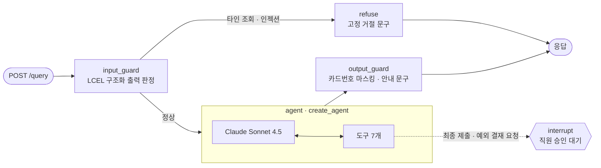

# 미니 PJT: 출장비 정산 사전 검토 Agent

## 무엇을 푸나
국내 출장을 다녀온 직원이 정산서를 **제출하기 전에** 영수증 누락·한도 초과·기한 초과를 스스로 확인하지 못해 반려와 재상신을 반복하는 문제를 푼다. 직원이 "대전 출장 정산 점검해줘"라고 말하면 본인 결제 내역을 규정과 대조해 문제 항목과 초과 금액을 알려 주고, 예외 결재 상태 확인과 **사람 승인 후 최종 제출**까지 이어 준다.

- 사용자: 출장을 다녀와 본인 출장비를 직접 정산하는 직원 (월 10여 명)
- 핵심 원칙: 정산이므로 **금액·날짜는 오차 0원**. 계산은 모델이 아니라 코드가 한다
- 상세 기획: [SERVICE.md](SERVICE.md) · 개발 규약: [CLAUDE.md](CLAUDE.md)

## 활용한 패턴 (Day 1~7)
| Day | 패턴 | 이 프로젝트에서 활용한 방법 |
|---|---|---|
| Day 1 | LCEL 체인 + Pydantic 구조화 출력 | 입력 가드레일 판정 `프롬프트 \| 모델.with_structured_output(GuardVerdict)` ([guards.py](src/guards.py)), 예외 결재 사유서 문단 작성 ([drafting.py](src/drafting.py)), 평가 Judge 판정 |
| Day 2 | RAG | 규정 문서를 `##` 조항 단위로 청킹 → Titan v2 임베딩 → Chroma 검색. 점검 답변의 근거 조항은 점검 결과로 정해 코드가 직접 붙임 ([retriever.py](src/retriever.py)) |
| Day 3 | ReAct · LangGraph | `create_agent`(모델 ↔ 도구 반복)를 하위 그래프로 넣고, 바깥 흐름은 `StateGraph` 와 조건부 분기로 직접 구성 ([agent.py](src/agent.py)) |
| Day 4 | 도구 다중 결합 | 도메인 도구 7개. 직원ID는 질문이 아닌 런타임 컨텍스트로 주입해 모델이 다른 직원을 고를 수 없음 ([tools.py](src/tools.py)) |
| Day 5 | 가드레일 | 입력: 타인 조회·프롬프트 인젝션 차단(도구 호출 전 거절). 출력: 카드번호 마스킹, 점검 안내 문구 부착 |
| Day 5 | HITL | 최종 제출과 예외 결재 요청 직전 `interrupt()` 로 멈추고(제출 요약 / 사유서 초안), 같은 대화의 승인 답변으로 `Command(resume)` 재개. 승인 판정은 코드가 하며, 요청한 직원만 승인 가능. 대화 상태는 `SqliteSaver` |
| Day 7 | Observability · Trace | 콜백 트레이서가 모델·도구 호출을 API 응답 `trace` 와 `logs/trace.jsonl` 에 기록 ([tracer.py](src/tracer.py)) |
| Day 7 | 평가 | 인-아웃 세트 자동 채점(숫자 정확 일치 + LLM-as-Judge 의미 판정), 계산 단위 테스트, 승인 흐름 시나리오, RAGAS 4개 지표 ([ragas_eval.py](evaluation/ragas_eval.py)) |

## 아키텍처


| 도구 | 역할 | 데이터 |
|---|---|---|
| get_my_trips | 내 출장 목록 | trips.json (+ 제출 기록) |
| get_trip_expenses | 출장 결제 내역 (카드번호 끝 4자리) | expenses.json |
| search_policy | 규정 벡터 검색 (RAG) | policy/travel_policy.md |
| check_settlement | 누락·한도·기한 점검 + 근거 조항 첨부 | settlement.py 계산 |
| get_approval_status | 예외 결재 상태 | approvals.json |
| submit_settlement | 재점검 → 직원 승인 → 제출 (HITL) | state/submissions.json |
| request_exception_approval | 대상 검증 → 사유서 초안 → 직원 승인 → 부서장 결재 요청 (HITL) | state/approvals.json |

- 계산 로직([settlement.py](src/settlement.py))은 LLM 호출이 없는 순수 함수다. 숙박은 나눗셈 없이 `결제 금액 − 1박 한도 × 박수` 로 계산해 원 단위 오차를 없앴다.
- 사유서 초안의 대상·초과 금액·결제ID·결재자는 점검 결과 값을 코드가 넣고, 모델은 직원이 말한 사유를 문단으로 다듬기만 한다. 예외 결재 요청 대상(실제 초과 여부, 이미 요청·승인된 건)도 코드가 검증한다.
- 제출·결재 요청 기록은 원본 데이터를 바꾸지 않고 `state/` 에 따로 남겨 평가를 항상 같은 조건에서 재현할 수 있다.

## 실행 방법
```bash
python -m venv .venv && .venv\Scripts\activate      # macOS·Linux: source .venv/bin/activate
pip install -r requirements.txt
copy .env.example .env                               # AWS 키와 BASE_DATE=2026-10-21 입력

pytest tests                                         # 계산·승인 판정 테스트 (LLM 호출 없음)
python src/agent.py                                  # 시험 질문 3개 실행
uvicorn src.api:app --reload                         # API 서버
```

API 호출 (직원은 `X-Employee-Id`, 대화는 `X-Thread-Id` 헤더로 구분):
```bash
curl -X POST localhost:8000/query -H "Content-Type: application/json" \
  -H "X-Employee-Id: EMP-004" -d '{"question": "대전 출장(TRIP-002) 정산 점검해줘"}'
# → {"answer": "...", "contexts": [{"doc_id": "경비 한도", "text": "..."}], "trace": [...]}
```
제출 요청이나 예외 결재 요청을 하면 확인 문구(제출 요약 또는 사유서 초안)와 함께 승인 대기 상태로 멈추고, 같은 `X-Thread-Id` 로 "승인"을 보내면 실행된다.

평가:
```bash
python evaluation/run_eval.py --round 2     # 인-아웃 세트 15건 → evaluation/round2_report.md
python evaluation/hitl_scenarios.py         # 승인 흐름 여러 턴 검증 → evaluation/hitl_report.md

pip install ragas==0.4.3 --no-deps          # RAGAS (의존성은 requirements.txt 에 포함)
python evaluation/ragas_eval.py --round 2   # 저장된 답변으로 RAGAS 측정 → evaluation/ragas_report.md
```

## RAGAS 평가 결과
round2 결과 중 근거 조항이 있는 9건 (규정 질문 3건, 점검 질문 6건) · 평가 모델 Claude Sonnet 4.5 · 임베딩 Titan v2 → [ragas_report.md](evaluation/ragas_report.md)

- context_recall: 0.85
- context_precision: 0.42
- faithfulness: 0.74
- answer_relevancy: 0.42

| 지표 | 전체 | 규정 질문 | 점검 질문 | 보정 전 |
|---|---|---|---|---|
| context_recall | 0.85 | 0.83 | 0.86 | 0.42 |
| context_precision | 0.42 | 0.67 | 0.30 | 0.48 |
| faithfulness | 0.74 | 0.67 | 0.77 | 0.28 |
| answer_relevancy | 0.42 | 0.52 | 0.37 | 0.24 |

- **측정 방식 보정:** 처음에는 contexts 에 규정 조항만 넣었는데(보정 전), 점검 답변의 근거는 규정 + `check_settlement` 결과 데이터다. 그래서 "식비 초과 13,000원" 같은 정확한 숫자까지 근거 없는 주장으로 세어 faithfulness 가 0.28 로 나왔다. contexts 에 Agent 가 실제로 받은 점검 결과(데이터에서 LLM 없이 재계산)를 넣고, answer_relevancy 의 질문 역생성 프롬프트를 한국어로 바꿔 다시 쟀다. 두 값을 모두 남긴다.
- **context_precision 이 낮은 이유:** 점검 답변에는 항상 한도·기한 줄이 들어가 근거 조항으로 `경비 한도`·`정산 기한` 을 늘 붙이는데, reference(expected_traits)는 문항별 핵심 판정만 담고 있어 이 조항들이 관련 없는 근거로 계산된다.
- **answer_relevancy:** 점검 답변은 표·근거·다음 할 일까지 포함한 정해진 형식이라 질문 한 줄과의 유사도가 낮게 나온다. #7(규정에 없는 항목)은 "담당자에게 확인하라"는 정책상 올바른 답을 RAGAS 가 회피성 답변으로 보고 0점을 준다.

## 인-아웃 세트 통과율 (자체 평가)
- 1차 (Day 9): 7 / 15 통과 → [round1_report.md](evaluation/round1_report.md)
- 2차 (Day 10 개선 후): 15 / 15 통과 → [round2_report.md](evaluation/round2_report.md)
- 개선폭: +8건
- 성공 기준(SERVICE.md 5번) 4개 모두 충족: 12건 이상 통과, 초과 금액 오차 0원, 영수증 누락 탐지 100%, 규정 날조 0건
- 승인 흐름 시나리오 10개(최종 제출 6 + 예외 결재 요청 4), 확인 항목 34/34 통과 ([hitl_report.md](evaluation/hitl_report.md))
- 계산·승인 판정·결재 요청 대상 검증 단위 테스트 61건 통과 (`pytest tests`, LLM 호출 없음)

인-아웃 세트는 공지 §4-4 의 7컬럼 뒤에 `employee` 컬럼을 추가했다. 이 서비스는 로그인 직원에 따라 조회 범위(본인 출장만)와 한도(평직원·임원)가 달라지므로, 문항마다 실행 직원을 고정해야 같은 조건으로 재현할 수 있다. 앞 7컬럼의 순서는 그대로 유지했다.

## 트라이앤에러 회고
**시도했지만 실패한 접근**
- 프롬프트로 "반드시 규정을 검색하라"고 지시 → 짧은 질문("교통비 한도 넘은 거 있어?")에서 모델이 검색을 건너뛰고 근거 없이 예외 결재 절차를 설명 (규정 날조 판정). 지시를 강하게 바꿔도 실행마다 결과가 달랐다.
- 고정 문구를 문자열 그대로 요구하는 채점 → "규정에 골프장 이용료에 대한 내용은 없습니다…"처럼 더 구체적이고 좋은 답변까지 실패 처리. 채점 기준이 좋은 답변을 나쁘게 고치는 방향으로 루프를 몰았다.
- 1박 단가를 먼저 정수로 나눈 뒤 비교 → 2박 335,001원이면 초과 금액 1원 오차, 2박 300,001원이면 초과 자체를 놓침. 평가 데이터(340,000원 ÷ 2)는 나눠떨어져 15건 평가로는 드러나지 않았고, Agent 연결 전에 계산을 따로 검증하라는 강사 피드백으로 경계 조건 테스트를 만들며 발견.

**최종 채택한 접근**
- 근거 조항을 `check_settlement` 가 점검 결과에 따라 **코드로 직접 첨부** → 규정 날조 4건 → 0건, 점검 질문의 모델 호출도 감소.
- 채점 원칙을 **숫자는 엄격(정확 일치), 문장은 의미(LLM-as-Judge)**로 재정의. Judge 출력은 근거를 결론보다 먼저 쓰게 해 근거와 결론이 어긋나는 판정을 줄임.
- 금액 계산은 나눗셈 없는 공식으로 바꾸고 단위 테스트로 고정.
- 사람 승인 도구는 승인 후 재개될 때 처음부터 다시 실행된다. 사유서 문단을 모델로 다시 만들면 직원이 본 초안과 저장되는 내용이 달라질 수 있어, 처음 만든 문단을 상태 파일에 보관해 재개 시 그대로 쓰게 했다.
- 3차 개발로 프롬프트가 길어진 뒤 "골프장 이용료도 정산돼?"에 규정을 검색하지 않고 "규정에 없다"고 답하는 회귀가 15건 재실행에서 잡혔다. 결론은 맞았지만 확인 없이 단정한 것이라, 규정 질문은 답하기 전에 반드시 검색하도록 지시를 추가했다. 통과한 문항을 지우지 않고 매번 전체를 다시 돌린 덕분에 잡혔다.
- RAGAS: `ragas 0.4.3` 은 Python 3.14 에서 테스트셋 생성용 의존성(scikit-network) 빌드가 실패하고, 최신 langchain-community 에서 삭제된 Vertex AI 모듈을 import 한다. 지표 계산에는 필요 없는 부분이라 의존성은 따로 설치하고, 평가 스크립트 안에서만 빈 모듈을 채워 넣어 해결했다.
- Agent가 규정 검색을 동시에 여러 번 호출할 때 벡터 저장소가 중복 생성되던 버그(같은 조항이 두 번 검색돼 '예외 결재' 조항이 밀려남)를 잠금과 고정 ID로 수정.
- 루프는 "한 번에 하나만 고치고 해당 문항만 재실행, 마지막에 전체 재실행으로 회귀 확인" 순서로 진행. 판정 기준을 바꿀 때는 Agent 재실행 없이 저장된 답변만 다시 채점(`--regrade`)해 기준 변경 효과와 모델 변경 효과를 분리했다.

**판정 기준 변경 이력 (공정성을 위해 기록)**
- round1 이후 expected_tools 에서 불필요한 `get_trip_expenses`·`search_policy` 조건 제거 (점검 도구가 결제 내역과 근거 조항을 함께 돌려주도록 설계가 바뀜)
- Judge 에 도구 결과를 함께 제공 (도구가 준 한도 숫자를 근거 없는 규정으로 오판하던 문제)
- 문장 trait·forbidden 을 문자열 일치에서 의미 판정으로 변경 (숫자는 그대로 정확 일치)
- round1 원본 결과와 리포트는 그대로 보존했고, 중간 결과는 evaluation/results/ 에 남겼다.

**남은 한계 · 향후 개선 방향**
- 한 번의 실행 결과다. 루프 중 일부 문항(#3, #7)이 실행마다 통과·실패를 오갔으므로 여러 번 실행해 경향을 봐야 한다.
- RAGAS 의 reference 는 정답 문장 대신 expected_traits 로 대체했다. 정답 문장 컬럼을 따로 만들면 context_recall·precision 을 더 정확히 잴 수 있다.
- 부서장이 결재를 승인·반려하는 화면은 없다. 이 Agent 는 직원 쪽 흐름(요청까지)만 다루고, 결재 결과는 데이터로 주어진다고 가정했다.
- 영수증 이미지 OCR 대조, 인사·재무 담당자용 전 직원 조회, 해외 출장은 범위 밖으로 남겼다.
- 트레이스는 로컬 JSONL 기록이다. 운영 환경이라면 LangSmith·LangFuse 같은 도구로 옮긴다.
- 데이터는 전부 더미다.

## 핵심 코드 위치
- `src/agent.py:96` — 메인 그래프 (`build_graph`: input_guard → agent → output_guard, refuse 분기)
- `src/agent.py:23` — 시스템 프롬프트
- `src/tools.py` — 도메인 도구 7개 (`check_settlement:199`, `submit_settlement:271`, `request_exception_approval:340`)
- `src/drafting.py` — 예외 결재 사유서 초안 (`polish_reason:24` LCEL 체인, `compose_request:30` 숫자는 코드가 기입)
- `src/settlement.py:63` — 정산 점검 계산 (`check_trip`)
- `src/retriever.py` — RAG 파이프라인 (`search:73`, 근거 조항 조회 `get_sections:67`)
- `src/guards.py` — 입력·출력 가드레일
- `src/api.py:71` — `POST /query`, 승인 대기 대화 재개
- `src/tracer.py` — 트레이스 기록
- `evaluation/run_eval.py` · `evaluation/hitl_scenarios.py` · `evaluation/ragas_eval.py` · `tests/`
