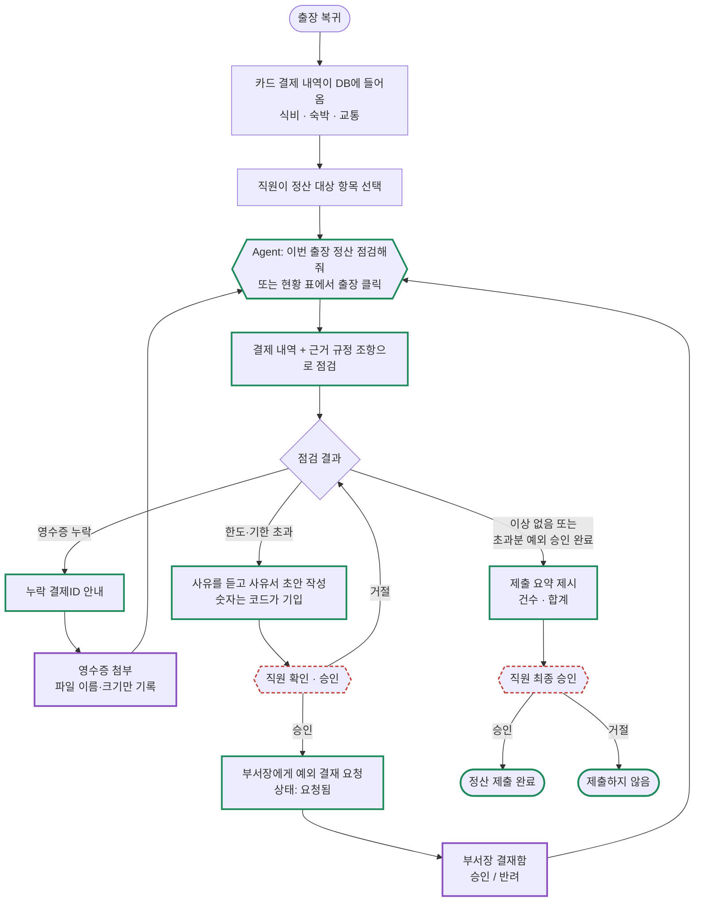
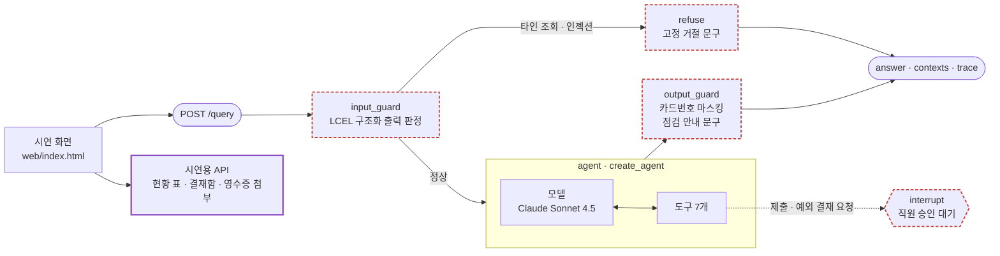
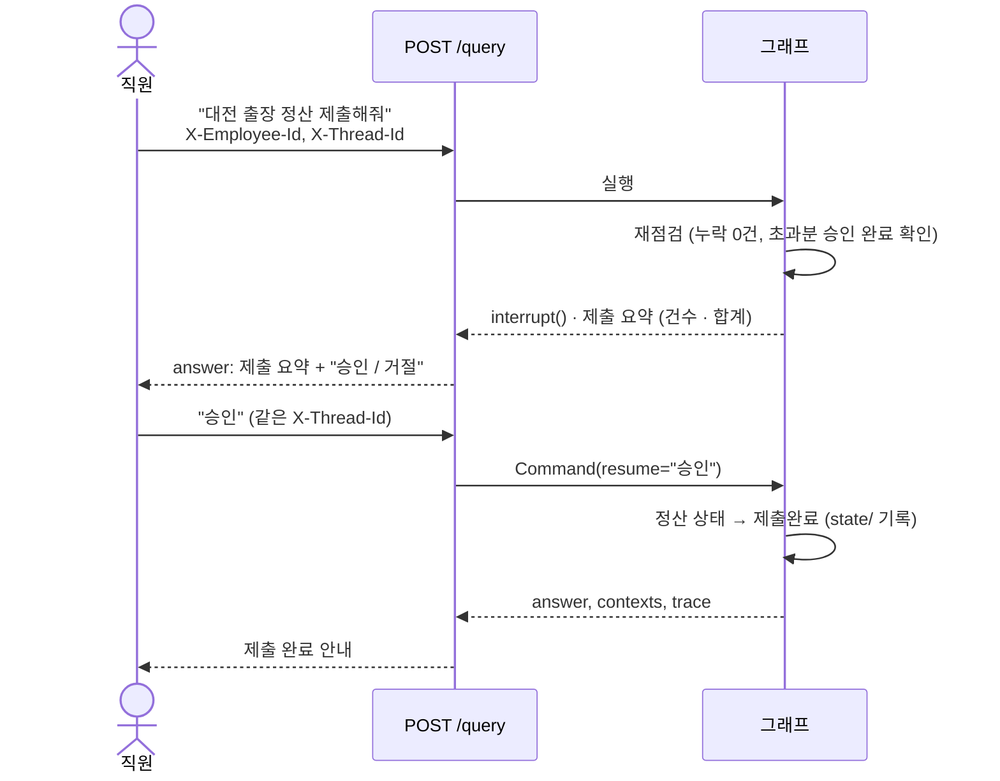

# 미니 PJT: 출장비 정산 사전 검토 Agent

## 무엇을 푸나
국내 출장을 다녀온 직원은 영수증 누락, 한도 초과, 기한 초과를 제출 전에 스스로 확인하기 어렵다. 그래서 정산서가 반려되고 다시 올리는 일이 되풀이된다. 이 Agent는 직원이 "대전 출장 정산 점검해줘"라고 말하면 본인 결제 내역을 규정과 대조해 문제 항목과 초과 금액을 알려 준다. 예외 결재 상태를 확인해 주고 직원이 승인하면 최종 제출까지 진행한다.

- 사용자: 출장을 다녀와 본인 출장비를 직접 정산하는 직원 (월 10여 명)
- 핵심 원칙: 정산이라 금액·날짜는 **오차 0원**이어야 한다. 계산은 모델이 아니라 코드가 한다
- 상세 기획: [SERVICE.md](SERVICE.md) · 개발 규약: [CLAUDE.md](CLAUDE.md)

### 업무 흐름 (직원 입장)
카드 결제가 들어온 뒤부터 정산 제출까지의 흐름이다. 점검 결과에 따라 세 갈래로 안내하고 조치가 끝나면 다시 점검한다. 초록 테두리는 Agent가 처리하는 단계, 보라 테두리는 끝까지 시연하려고 붙인 시연용 기능(Agent 범위 밖, 모델 호출 없음), 빨간 점선은 사람 승인 단계다.



## 활용한 패턴 (Day 1~7)
| Day | 패턴 | 이 프로젝트에서 활용한 방법 |
|---|---|---|
| Day 1 | LCEL 체인 + Pydantic 구조화 출력 | 입력 가드레일 판정 `프롬프트 \| 모델.with_structured_output(GuardVerdict)` ([guards.py](src/guards.py)), 예외 결재 사유서 문단 작성 ([drafting.py](src/drafting.py)), 평가 Judge 판정 |
| Day 2 | RAG (하이브리드) | 규정 문서를 `##` 조항 단위로 청킹 → Titan v2 임베딩 벡터 검색 + kiwipiepy 형태소 BM25 키워드 검색을 순위 융합(RRF). 점검 답변의 근거 조항은 점검 결과로 정해 코드가 직접 붙임 ([retriever.py](src/retriever.py)) |
| Day 3 | ReAct · LangGraph | `create_agent`(모델 ↔ 도구 반복)를 하위 그래프로 넣고 바깥 흐름은 `StateGraph` 와 조건부 분기로 직접 구성 ([agent.py](src/agent.py)) |
| Day 4 | 도구 다중 결합 | 도메인 도구 7개. 직원ID는 질문이 아닌 런타임 컨텍스트로 주입해 모델이 다른 직원을 고를 수 없음 ([tools.py](src/tools.py)) |
| Day 5 | 가드레일 | 입력: 타인 조회·프롬프트 인젝션 차단(도구 호출 전 거절). 출력: 카드번호 마스킹, 점검 안내 문구 부착 |
| Day 5 | HITL | 최종 제출과 예외 결재 요청 직전 `interrupt()` 로 멈추고(제출 요약 / 사유서 초안), 같은 대화의 승인 답변으로 `Command(resume)` 재개. 승인 판정은 코드가 하며 요청한 직원만 승인 가능. 대화 상태는 `SqliteSaver` |
| Day 7 | Observability · Trace | 콜백 트레이서가 모델·도구 호출을 API 응답 `trace` 와 `logs/trace.jsonl` 에 기록 ([tracer.py](src/tracer.py)) |
| Day 7 | 평가 | 인-아웃 세트 자동 채점(숫자 정확 일치 + LLM-as-Judge 의미 판정), 계산 단위 테스트, 승인 흐름 시나리오, RAGAS 4개 지표 ([ragas_eval.py](evaluation/ragas_eval.py)) |

## 아키텍처
요청은 시연 화면과 API를 거쳐 LangGraph 그래프로 들어간다. 바깥 흐름은 `StateGraph` 로 직접 그렸고 가운데 Agent 노드는 `create_agent` 가 만든 모델 ↔ 도구 반복 그래프다. 가드레일은 그래프에 고정된 단계라 모델이 건너뛸 수 없다.



| 구분 | 이름 | 역할 | 데이터 |
|---|---|---|---|
| Agent 도구 | get_my_trips | 내 출장 목록 | trips.json (+ 제출 기록) |
| Agent 도구 | get_trip_expenses | 출장 결제 내역 (카드번호 끝 4자리) | expenses.json (+ 첨부 기록) |
| Agent 도구 | search_policy | 규정 검색 (벡터 + BM25 하이브리드, RRF) | policy/travel_policy.md |
| Agent 도구 | check_settlement | 누락·한도·기한 점검 + 근거 조항 코드 첨부 | settlement.py 계산 |
| Agent 도구 | get_approval_status | 예외 결재 상태 | approvals.json (+ 요청 기록) |
| Agent 도구 | submit_settlement | 재점검 → 직원 승인 → 제출 (HITL) | state/submissions.json |
| Agent 도구 | request_exception_approval | 대상 검증 → 사유서 초안 → 직원 승인 → 부서장 결재 요청 (HITL) | state/approvals.json |
| 시연용 API | `GET /trips/mine` | 내 출장 정산 현황 표 (점검 계산 그대로) | — |
| 시연용 API | `/approvals/inbox` · `/approvals/{id}/decision` | 부서장 결재함 (결재자 본인만 요청됨 건을 승인·반려) | state/approvals.json |
| 시연용 API | `/receipts/missing` · `/receipts/{id}` | 영수증 첨부 (파일 내용은 보내지도 읽지도 않고 이름·크기만 기록) | state/receipts.json |

- 계산 로직([settlement.py](src/settlement.py))은 LLM을 부르지 않는 순수 함수다. 숙박은 `결제 금액 − 1박 한도 × 박수` 로 나눗셈 없이 계산해서 원 단위 오차가 생기지 않는다.
- 사유서 초안의 대상, 초과 금액, 결제ID, 결재자는 점검 결과 값을 코드가 넣는다. 모델은 직원이 말한 사유를 문단으로 다듬기만 한다. 예외 결재를 요청할 수 있는 대상인지(실제로 초과됐는지, 이미 요청·승인된 건인지)도 코드가 검증한다.
- 제출·결재 요청 기록은 원본 데이터를 건드리지 않고 `state/` 에 따로 남긴다. 그래서 평가는 항상 같은 조건에서 다시 돌릴 수 있다.

### 점검 판정 규칙 (`check_settlement`)
정산 대상으로 선택한 결제만 본다. 금액·날짜 계산은 [settlement.py](src/settlement.py) 가 하고 경계 조건까지 단위 테스트로 고정했다.

| 점검 | 단위 | 판정 기준 | 평직원 | 임원 |
|---|---|---|---|---|
| 영수증 누락 | 결제 항목 | 정산 대상인데 스캔본 미첨부 → 1건이라도 있으면 제출 불가 | — | — |
| 식비 한도 | 날짜 | 같은 날 식비 합계 − 한도 | 70,000원 | 100,000원 |
| 숙박 한도 | 결제 1건 | 결제 금액 − 1박 한도 × 박수 (나눗셈 없이 계산해 원 단위 오차 0) | 150,000원/박 | 200,000원/박 |
| 교통비 한도 | 날짜 | 같은 날 교통비 합계 − 한도 | 100,000원 | 100,000원 |
| 정산 기한 | 출장 건 | 복귀 다음 영업일부터 7영업일 (주말·공휴일 제외). 제출완료 건은 제출일 기준 | 공통 | 공통 |

한도나 기한을 넘긴 항목은 예외 결재 상태로 판정한다. 결재가 승인됐으면 "초과지만 예외 승인 완료, 정산 가능", 요청 중이면 "결재 대기", 반려됐거나 결재가 없으면 "예외 결재 필요"다. 초과분은 개인 부담이 아니라 사유서와 부서장 예외 결재로 정산한다.

### 사람 승인이 오가는 방식 (HITL)
요청 body 는 `{"question"}` 하나만 받는다. 직원과 대화는 헤더로 구분하고 승인을 기다리는 대화는 같은 `X-Thread-Id` 로 이어서 재개한다. 시연 화면에서는 [승인]/[거절] 버튼이 이 요청을 대신 보낸다.



### 개발 단계
| 단계 | 만든 것 | 상태 |
|---|---|---|
| 1차 | 더미 데이터·규정 문서, 조회 2개, 규정 검색, 점검, 가드레일 그래프 | 완료 |
| 2차 | 결재 상태 조회, 최종 제출 (사람 승인) | 완료 |
| 3차 | 사유서 작성 + 예외 결재 요청 (사람 승인) | 완료 |
| 이후 | 시연 화면(현황 표·승인 버튼), 시연용 부서장 결재함·영수증 첨부, 하이브리드 검색, Dockerfile·run.sh | 완료 |

## 실행 방법
Python 3.12 이상이 필요하다. `.env.example` 을 `.env` 로 복사해 AWS 키를 넣는다. `BASE_DATE=2026-10-21` 을 넣으면 평가와 같은 숫자가 나온다.

#### Docker (클린 환경 재현)
```bash
docker build -t travel-settlement-agent .
docker run --rm -p 8000:8000 --env-file .env travel-settlement-agent          # 서버 + 시연 화면
docker run --rm --env-file .env travel-settlement-agent ./run.sh test          # 단위 테스트
```

#### 로컬
```bash
python -m venv .venv && .venv\Scripts\activate      # macOS·Linux: source .venv/bin/activate
pip install -r requirements.txt
pip install ragas==0.4.3 --no-deps                   # RAGAS 평가용 (아래 회고 참고)

./run.sh test     # 단위 테스트 94건 (LLM 호출 없음)        = pytest tests
./run.sh server   # API 서버 + 시연 화면                    = uvicorn src.api:app --port 8000
./run.sh eval 3   # 인-아웃 세트 15건 → evaluation/round3_report.md
./run.sh hitl     # 승인 흐름 여러 턴 검증 → evaluation/hitl_report.md
./run.sh ragas 3  # 저장된 답변으로 RAGAS 측정 → evaluation/ragas_round3_report.md
./run.sh reset    # 시연 상태(제출·결재·첨부 기록) 초기화
```

#### 시연 화면
서버를 띄우고 브라우저에서 http://localhost:8000/ 을 연다.

로그인 직원을 고르면 위쪽에 "내 출장 정산 현황" 표가 나온다. 정산 대상 건수와 합계, 상태, 정산 기한이 보이고 숫자는 점검 계산 결과를 그대로 쓴다(모델 호출 없음). 출장을 누르면 Agent가 점검을 시작하고 제출할 수 있는 건은 [제출] 버튼으로 바로 제출을 요청한다. 표로 할 수 없는 질문(예외 결재 요청, 규정 질문, 가드레일 시연)은 입력창 옆 [예시 질문]에 모아 두었다.

질문하면 답변(결제 표와 요약 배지), 근거 규정 조항(contexts), 실행 단계(trace)가 함께 보인다. 제출이나 예외 결재 요청은 [승인]/[거절] 버튼으로 이어진다.

로그인 직원을 부서장(강태호)으로 바꾸면 시연용 결재함이 열리고 직원이 올린 예외 결재를 승인하거나 반려한다. 오른쪽 영수증 첨부 패널에서는 본인의 영수증 누락 결제에 아무 파일이나 골라 첨부한다. 파일 내용은 서버로 보내지 않고 이름과 크기만 기록한다. 결재함과 영수증 첨부는 Agent 범위 밖의 단순 API다. 이 둘까지 쓰면 점검 → 영수증 첨부 → 예외 결재 요청 → 부서장 승인 → 재점검 → 최종 제출을 한 화면에서 끝까지 보여 줄 수 있다.

시연을 처음 상태로 되돌리려면 `state/` 폴더를 지운다(`./run.sh reset`).

#### API 호출
직원은 `X-Employee-Id`, 대화는 `X-Thread-Id` 헤더로 구분한다.
```bash
curl -X POST localhost:8000/query -H "Content-Type: application/json" \
  -H "X-Employee-Id: EMP-004" -d '{"question": "대전 출장(TRIP-002) 정산 점검해줘"}'
# → {"answer": "...", "contexts": [{"doc_id": "경비 한도", "text": "..."}], "trace": [...]}
```
제출이나 예외 결재를 요청하면 확인 문구(제출 요약 또는 사유서 초안)를 돌려주고 승인 대기 상태로 멈춘다. 같은 `X-Thread-Id` 로 "승인"을 보내면 실행된다.

## RAGAS 평가 결과
최종 코드(round3) 결과 중 근거 조항이 있는 9건(규정 질문 3건, 점검 질문 6건)을 쟀다. 평가 모델은 Claude Sonnet 4.5, 임베딩은 Titan v2다. 상세: [ragas_round3_report.md](evaluation/ragas_round3_report.md)

- context_recall: 0.83
- context_precision: 0.48
- faithfulness: 0.71
- answer_relevancy: 0.41

| 지표 | Round 3 전체 | 규정 질문 | 점검 질문 | Round 2 (벡터 검색만) | Round 2 보정 전 |
|---|---|---|---|---|---|
| context_recall | 0.83 | 0.83 | 0.83 | 0.85 | 0.42 |
| context_precision | 0.48 | 0.67 | 0.38 | 0.42 | 0.48 |
| faithfulness | 0.71 | 0.60 | 0.77 | 0.74 | 0.28 |
| answer_relevancy | 0.41 | 0.52 | 0.36 | 0.42 | 0.24 |

Round 2에서 Round 3으로 넘어오며 검색을 벡터에서 하이브리드로 바꿨지만 지표 차이는 평가 모델이 흔들리는 정도에 그친다. 점검 질문의 근거 조항은 검색과 상관없이 코드가 똑같이 붙이는데도 context_precision 이 0.30에서 0.38로 움직였다. 그래서 ±0.08 정도는 측정 오차로 본다. 규정 문서가 조항 5개뿐이라 하이브리드의 이점이 지표에 드러나기 어렵다. 대신 "TR-102 양식" 같은 키워드 질의를 BM25가 1순위로 찾는 것은 단위 테스트로 확인했다. (Round 2 상세: [ragas_round2_report.md](evaluation/ragas_round2_report.md))

측정 방식도 한 번 고쳤다. 처음(보정 전)에는 contexts 에 규정 조항만 넣었는데 점검 답변의 실제 근거는 규정과 `check_settlement` 결과 데이터다. 그 바람에 "식비 초과 13,000원" 같은 정확한 숫자까지 근거 없는 주장으로 세어 faithfulness 가 0.28로 나왔다. Agent가 실제로 받은 점검 결과(데이터에서 LLM 없이 재계산)를 contexts 에 넣고 answer_relevancy 의 질문 역생성 프롬프트를 한국어로 바꿔 다시 쟀다. 두 값은 모두 남겨 두었다.

context_precision 이 낮은 이유는 점검 답변에 늘 한도·기한 줄이 들어가 근거 조항으로 `경비 한도`·`정산 기한` 을 항상 붙이기 때문이다. reference(expected_traits)는 문항별 핵심 판정만 담고 있어서 이 조항들이 관련 없는 근거로 계산된다.

answer_relevancy 는 점검 답변이 표, 근거, 다음 할 일까지 담은 정해진 형식이라 질문 한 줄과의 유사도가 낮게 나온다. #7(규정에 없는 항목)에서는 "담당자에게 확인하라"는 정책상 올바른 답을 RAGAS가 회피성 답변으로 보고 0점을 준다.

## 인-아웃 세트 통과율 (자체 평가)
- 1차 (Day 9): 7 / 15 통과 → [round1_report.md](evaluation/round1_report.md)
- 2차 (Day 10 개선 후): 15 / 15 통과 → [round2_report.md](evaluation/round2_report.md) (사람 확인 완료)
- 개선폭: +8건 (판정 기준 수정 +4, Agent 개선 +4. 내역은 round2 리포트 끝에 있다)
- 최종 회귀 (3차, 2·3차 개발·시연 기능·하이브리드 검색 반영 후): 15 / 15 통과 → [round3_report.md](evaluation/round3_report.md)
- 성공 기준(SERVICE.md 5번) 4개 모두 충족: 12건 이상 통과, 초과 금액 오차 0원, 영수증 누락 탐지 100%, 규정 날조 0건 (round2·round3 모두)
- 승인 흐름 시나리오 12개(최종 제출 6 + 예외 결재 요청 4 + 부서장 승인·영수증 첨부까지 가는 전체 흐름 2), 확인 항목 46/46 통과 ([hitl_report.md](evaluation/hitl_report.md))
- 계산, 승인 판정, 결재 요청 대상 검증, 부서장 결재, 영수증 첨부, 정산 현황, 하이브리드 검색 단위 테스트 94건 통과 (`pytest tests`, LLM 호출 없음)

인-아웃 세트에는 공지 §4-4 의 7컬럼 뒤에 `employee` 컬럼을 하나 더했다. 이 서비스는 로그인 직원에 따라 조회 범위(본인 출장만)와 한도(평직원·임원)가 달라진다. 문항마다 실행 직원을 고정해야 같은 조건으로 재현할 수 있어서다. 앞 7컬럼의 이름과 순서는 그대로다.

## 트라이앤에러 회고
#### 시도했지만 실패한 접근
- 프롬프트에 "반드시 규정을 검색하라"고 적었다. 그런데 "교통비 한도 넘은 거 있어?" 같은 짧은 질문에서는 모델이 검색을 건너뛰고 근거 없이 예외 결재 절차를 설명했다(규정 날조 판정). 지시를 더 세게 고쳐도 실행할 때마다 결과가 달랐다.
- 고정 문구를 글자 그대로 요구하도록 채점했다. 그러자 "규정에 골프장 이용료에 대한 내용은 없습니다…"처럼 더 구체적이고 좋은 답변까지 실패로 처리됐다. 채점 기준이 좋은 답변을 나쁘게 고치는 쪽으로 루프를 몰고 간 셈이다.
- 숙박비는 1박 단가를 먼저 정수로 나눈 뒤 한도와 비교했다. 이 방식은 2박 335,001원이면 초과 금액이 1원 틀리고 2박 300,001원이면 초과 자체를 놓친다. 평가 데이터(340,000원 ÷ 2)는 나눠떨어져서 15건 평가로는 드러나지 않았다. Agent에 붙이기 전에 계산부터 따로 검증하라는 강사 피드백을 받고 경계 조건 테스트를 만들다가 찾았다.

#### 최종 채택한 접근
- 근거 조항은 `check_settlement` 가 점검 결과에 맞춰 코드로 직접 붙인다. 규정 날조가 4건에서 0건이 됐고 점검 질문에서 모델을 부르는 횟수도 줄었다.
- 채점 원칙을 "숫자는 정확히 일치, 문장은 의미가 맞으면 통과(LLM-as-Judge)"로 다시 정했다. Judge는 근거를 먼저 쓰고 결론을 나중에 쓰게 해서 근거와 결론이 어긋나는 판정을 줄였다.
- 금액 계산은 나눗셈 없는 공식으로 바꾸고 단위 테스트로 묶어 두었다.
- 사람 승인 도구는 승인 후 재개될 때 처음부터 다시 실행된다. 이때 사유서 문단을 모델로 새로 만들면 직원이 본 초안과 실제로 저장되는 내용이 달라질 수 있다. 그래서 처음 만든 문단을 상태 파일에 보관했다가 재개할 때 그대로 쓴다.
- 시연하다가 이미 제출완료된 출장이 "기한 경과, 예외 결재 필요"로 나오는 모순을 찾았다. 제출일 없이 상태만 있어서 기한을 오늘 기준으로 판정한 탓이었다. 제출완료 건은 제출일 기준으로 판정하고 남은 조치를 표시하지 않게 고쳤다.
- 3차 개발로 프롬프트가 길어진 뒤, "골프장 이용료도 정산돼?"에 규정을 검색하지 않고 "규정에 없다"고 답하는 회귀를 15건 재실행에서 잡았다. 결론은 맞았지만 확인 없이 단정한 답이었다. 규정 질문은 답하기 전에 반드시 검색하도록 지시를 더했다. 통과한 문항을 지우지 않고 매번 전체를 다시 돌린 덕분에 잡을 수 있었다.
- Dockerfile 을 만들면서 Python 3.12 리눅스 기준으로 의존성을 검증하다가 문제 두 가지를 찾았다. RAGAS 의존성을 설치할 때 `langchain-core` 가 1.6.9에서 1.6.13으로 올라갔는데 requirements 에는 옛 버전이 남아 있었다. 또 `networkx 3.7` 은 Python 3.12 이상만 지원했다. requirements 를 실제로 테스트한 버전에 맞추고 지원 버전을 3.12+ 로 적었다.
- `ragas 0.4.3` 은 Python 3.14에서 테스트셋 생성용 의존성(scikit-network) 빌드에 실패하고 최신 langchain-community 에서 없어진 Vertex AI 모듈을 import 한다. 둘 다 지표 계산에는 쓰이지 않는다. 그래서 의존성은 따로 설치하고 평가 스크립트 안에서만 빈 모듈을 채워 넣었다.
- Agent가 규정 검색을 동시에 여러 번 호출하면 벡터 저장소가 두 번 만들어지는 버그가 있었다. 같은 조항이 두 번 검색되면서 '예외 결재' 조항이 결과 밖으로 밀려났다. 저장소 생성에 잠금을 걸고 조항마다 고정 ID를 줘서 고쳤다.
- 루프는 한 번에 하나만 고치고 해당 문항만 다시 돌린 뒤, 마지막에 전체를 다시 돌려 회귀를 확인하는 순서로 진행했다. 판정 기준을 바꿀 때는 Agent를 다시 실행하지 않고 저장된 답변만 다시 채점(`--regrade`)해서, 기준 변경의 효과와 모델 변경의 효과를 따로 볼 수 있게 했다.

#### 판정 기준 변경 이력 (공정성을 위해 기록)
- round1 이후 expected_tools 에서 불필요한 `get_trip_expenses`·`search_policy` 조건을 뺐다. 점검 도구가 결제 내역과 근거 조항을 함께 돌려주도록 설계가 바뀌었기 때문이다.
- Judge에 도구 결과를 함께 넘겼다. 도구가 준 한도 숫자를 근거 없는 규정으로 오판하는 문제가 있었다.
- 문장 trait 와 forbidden 은 글자 일치에서 의미 판정으로 바꿨다. 숫자는 지금도 정확히 일치해야 한다.
- round1 원본 결과와 리포트는 그대로 두었고 중간 결과는 evaluation/results/ 에 남겼다.

#### 남은 한계와 향후 개선 방향
- 결과는 한 번 실행한 값이다. 루프 중에 일부 문항(#3, #7)이 실행할 때마다 통과와 실패를 오갔으니 여러 번 돌려 경향을 봐야 한다.
- RAGAS 의 reference 는 정답 문장 대신 expected_traits 로 채웠다. 정답 문장 컬럼을 따로 만들면 context_recall·precision 을 더 정확히 잴 수 있다.
- 부서장 결재는 시연용 결재함(단순 API)으로만 만들었다. 실제로는 사내 결재 시스템과 연동해야 하고 Agent의 사용자는 직원 본인으로 한정했다.
- 영수증 첨부는 시연용 기록(파일 이름·크기)만 남긴다. 실제 파일 보관, 이미지 OCR 금액 대조, 인사·재무 담당자용 전 직원 조회, 해외 출장은 범위 밖이다.
- 트레이스는 LangChain 콜백으로 직접 만든 기록기(Day 7 실습의 로컬 트레이서 방식)다. 외부 서비스 계정이나 키 없이 누구나 재현할 수 있고 같은 기록을 API 응답 `trace` 로 돌려줘 화면에서 바로 보여 줄 수 있어서 골랐다. 운영 환경이라면 같은 콜백 지점에 LangSmith·LangFuse 를 붙여 오래 보관하고 검색한다.
- 이 PC에 Docker 가 없어서 이미지 빌드는 직접 확인하지 못했다. 대신 Python 3.12 리눅스 기준으로 requirements 전체가 설치되는지 pip 로 검증했다.
- 데이터는 모두 더미다.

## 핵심 코드 위치
- `src/agent.py:96`: 메인 그래프 (`build_graph`: input_guard → agent → output_guard, refuse 분기)
- `src/agent.py:23`: 시스템 프롬프트
- `src/tools.py`: 도메인 도구 7개 (`check_settlement:338`, `submit_settlement:413`, `request_exception_approval:482`)
- `src/drafting.py`: 예외 결재 사유서 초안 (`polish_reason:24` LCEL 체인, `compose_request:30` 숫자는 코드가 기입)
- `src/settlement.py:63`: 정산 점검 계산 (`check_trip`)
- `src/retriever.py`: RAG 파이프라인 (하이브리드 `search:116`, BM25 `bm25_rank:98`, 근거 조항 조회 `get_sections:69`)
- `src/guards.py`: 입력·출력 가드레일
- `src/api.py:75`: `POST /query`, 승인 대기 대화 재개
- `web/index.html`: 시연 화면 (`GET /`, 외부 라이브러리 없는 단일 파일)
- `src/tracer.py`: 트레이스 기록
- `evaluation/run_eval.py` · `evaluation/hitl_scenarios.py` · `evaluation/ragas_eval.py` · `tests/`
- `Dockerfile` · `run.sh`: 클린 환경 재현, 실행 명령 모음
